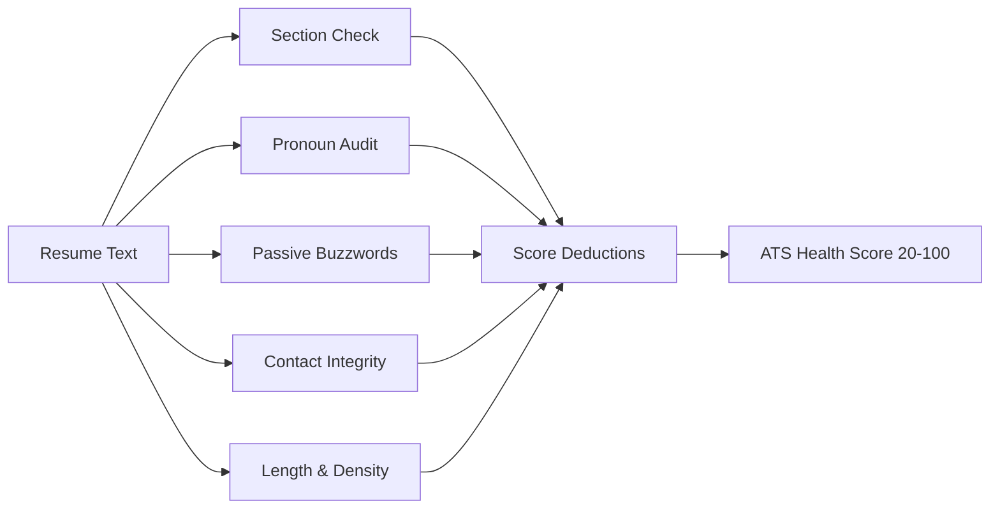

# ATS Skills Engine: Architecture & Tuning Runbook

The **ATS Skills Engine** is the core intelligence layer of the AI Resume & ATS Analyzer. It implements a hybrid scoring paradigm combining **deterministic mathematical vector cosine similarity** with **probabilistic LLM qualitative evaluations** (Groq LLaMA 3.3, Anthropic Claude 3.5, and OpenAI GPT-4o).

---

## 1. Engine Architecture & Component Map

| Component | File Location | Responsibility |
| :--- | :--- | :--- |
| **Semantic Vector Engine** | `server/services/semanticEngine.js` | N-gram tokenization, TF-IDF calculation, cosine vector similarity. |
| **ATS Trap Detector** | `server/services/atsTrapDetector.js` | Header parseability, contact checks, pronoun/buzzword audits. |
| **LLM Evaluation Engine** | `server/services/llm.js` | Multi-dimensional scoring, keyword gap checklist, and bullet rewrites. |
| **Live Re-scoring Engine** | `server/routes/analyze.js` (`/api/rescore-live`) | Sub-10ms deterministic live score adjustments for the in-browser editor. |
| **Batch Screening Engine** | `server/routes/analyze.js` (`/api/batch-screen`) | Multi-resume candidate ranking with dynamic recruiter weight presets. |
| **Binary PDF Generator** | `server/services/pdfGenerator.js` | Server-side binary PDF streaming (`pdfkit`) for tailored resumes and audit sheets. |

---

## 2. Mathematical Scoring Formulas

### 2.1 Hybrid Candidate Match Score
To eliminate LLM score variance across consecutive runs while preserving qualitative insight, the system balances deterministic vector overlap with LLM evaluation:

$$\text{Overall Score} = \text{round}\Big(0.65 \times \text{LLM Score} + 0.35 \times \text{Vector Cosine Score}\Big)$$

- **LLM Score (0–100):** Weighted multi-dimensional composite:
  - Skills Match: 40%
  - Experience & Seniority Fit: 30%
  - Quantifiable Impact (metrics, scale): 20%
  - ATS Formatting & Readability: 10%
- **Vector Cosine Score (0–100):** Computed over vocabulary $V$ formed by resume tokens $R$ and job description tokens $J$:

$$\text{Cosine Similarity} = \frac{\vec{v}_R \cdot \vec{v}_J}{\|\vec{v}_R\|_2 \times \|\vec{v}_J\|_2} = \frac{\sum_{t \in V} \text{TF-IDF}(t, R) \times \text{TF-IDF}(t, J)}{\sqrt{\sum_{t \in V} \text{TF-IDF}(t, R)^2} \times \sqrt{\sum_{t \in V} \text{TF-IDF}(t, J)^2}}$$

### 2.2 Term Frequency & Smoothed Inverse Document Frequency
- **Term Frequency:** Log-normalized frequency:
  $$\text{TF}(t, d) = 1 + \ln(\text{count}(t, d)) \quad \text{if } \text{count}(t, d) > 0$$
- **Inverse Document Frequency:** Smoothed IDF over the 2-document corpus ($N = 2$):
  $$\text{IDF}(t) = \ln\left(1 + \frac{N + 1}{1 + \text{df}(t)}\right) + 1$$

---

## 3. N-Gram Tokenization & Technical Bigram Extraction

In `server/services/semanticEngine.js`, tokenization handles technical syntax (e.g. `C++`, `Node.js`, `.NET`, `CI/CD`) and captures multi-word engineering concepts:

```javascript
// Technical Bigrams preserved during tokenization
const TECHNICAL_BIGRAMS = [
  "ci cd", "react native", "system design", "machine learning",
  "data science", "cloud infrastructure", "microservices architecture",
  "full stack", "distributed systems", "rest api", "unit testing"
];
```

### Stop-Words Strategy
Standard English stop words (`the`, `and`, `is`, `for`) along with generic resume meta-words (`responsibilities`, `qualifications`, `preferred`, `years`) are pruned to avoid artificial vector skewing.

---

## 4. ATS Parseability Trap & Red Flag Rules

Implemented in `server/services/atsTrapDetector.js`. Resumes start at a baseline of `100` health points with deductions applied for critical ATS parsing blockers:



### Trap Deductions Reference Table
| Trap ID | Category | Severity | Deduction | Trigger Condition |
| :--- | :--- | :--- | :--- | :--- |
| `missing_experience` | Section Structure | **Critical** | -15 pts | Missing standard `EXPERIENCE` header. |
| `missing_education` | Section Structure | **Critical** | -15 pts | Missing standard `EDUCATION` header. |
| `missing_skills` | Section Structure | **Critical** | -15 pts | Missing standard `SKILLS` header. |
| `missing_email` | Contact Integrity | **Critical** | -20 pts | No valid RFC 5322 email regex match. |
| `missing_phone` | Contact Integrity | **Warning** | -5 pts | No formatted phone number detected. |
| `missing_profiles` | Digital Footprint | **Info** | -5 pts | Neither LinkedIn nor GitHub URL found. |
| `pronoun_overuse` | Grammar & Tone | **Warning / Critical** | -2 pts / pronoun | > 3 first-person pronouns (`I`, `me`, `my`, `we`). |
| `resume_too_short` | Content Depth | **Critical** | -20 pts | Total word count < 200 words. |

---

## 5. Recruiter Mode Dynamic Weight Presets

In `server/routes/analyze.js` and `client/src/components/RecruiterScreening.jsx`, batch applicant rankings can be dynamically modulated:

| Preset Name | Semantic Overlap | ATS Formatting | Base LLM Score | Primary Use Case |
| :--- | :---: | :---: | :---: | :--- |
| **Balanced Standard** | 50% | 30% | 20% | Default generalist engineering roles. |
| **Deep Technical Focus** | 75% | 15% | 10% | Senior backend, systems, and ML engineering. |
| **ATS Parseability Strict** | 30% | 50% | 20% | Enterprise legacy ATS gateways (Taleo, Workday). |

---

## 6. Prompt Tuning Guidelines & Structured JSON Mode

When adjusting LLM evaluation prompts in `server/prompts/`:
1. **Always enforce JSON Object output:**
   - Groq: `response_format: { type: "json_object" }`
   - OpenAI: `response_format: { type: "json_object" }`
   - Anthropic: Strict system prompt JSON isolation.
2. **Deterministic Fallback:** Never rely solely on LLM regex extraction. Always sanitize code fences (` ```json `) using regex cleanup before `JSON.parse()`.
3. **Quantifiable Bullet Rewrites:** Prompt instructions must demand metrics (percentages, dollar values, throughput scale) in every rewrite recommendation.

---

## 7. Native Binary PDF Export Pipeline (`pdfkit`)

The PDF generation engine compiles server-side binary PDF buffers directly in Node.js without browser print dependencies:

### 7.1 Tailored Resume PDF (`generateTailoredPdf`)
- Standard 45pt margins ensuring full OCR compatibility with Workday, Greenhouse, and Taleo parsers.
- Automatic substitution of weak bullet points with quantified AI rewrites via `applyBulletRewrites`.
- Built-in PDFKit core standard fonts (`Helvetica`, `Helvetica-Bold`) for zero-dependency Alpine Docker runtime execution.
- Dynamic page numbering via buffered page ranges (`Page X of Y`).

### 7.2 ATS Compliance Audit Sheet PDF (`generateAuditSheetPdf`)
- Recruiter-grade summary banner displaying Overall Match Score and alignment tier.
- 4-column scoring methodology matrix (Hard Skills, Experience Fit, Quantifiable Impact, ATS Formatting).
- Missing keyword gap checklist with placement recommendations.
- Before/after bullet optimization comparison table.
