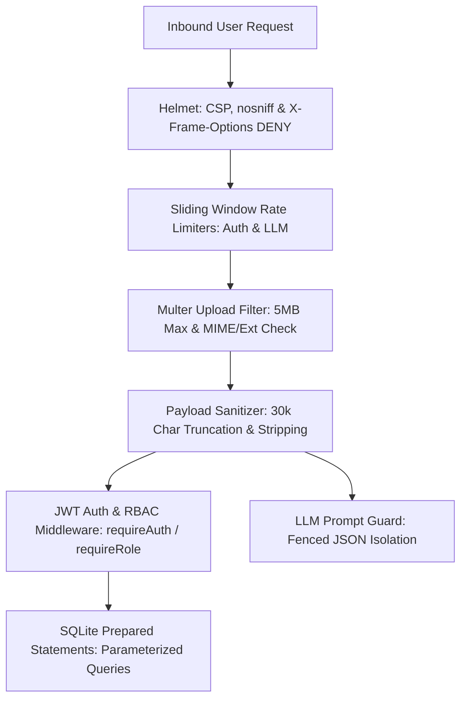

# Security Architecture & Hardening Runbook

This skill outlines the defensive security architecture, input validation rules, threat mitigations, and compliance checklists implemented across the **AI Resume & ATS Analyzer**.

---

## 1. Threat Model & Security Controls Map



| Threat Vector | Mitigation Strategy | File Reference |
| :--- | :--- | :--- |
| **Credential Stuffing & Brute-Force** | IP-based sliding window rate limiter (15 attempts / 15 min) with standard `RateLimit-*` headers. | `server/middleware/rateLimiter.js` |
| **LLM Token Exhaustion / DoS** | IP-based sliding window rate limiter (30 requests / 15 min) for AI generation endpoints. | `server/middleware/rateLimiter.js` |
| **MIME-Sniffing & Clickjacking** | Helmet security headers (`X-Content-Type-Options: nosniff`, `X-Frame-Options: DENY`, strict CSP). | `server/index.js` |
| **Privilege Escalation** | Role-Based Access Control (RBAC) with `job_seeker`, `recruiter`, and `admin` roles gating `/api/batch-screen`. | `server/middleware/authMiddleware.js` |
| **Denial of Service (Large Files)** | Strict 5MB file size limit enforced at Multer storage layer. | `server/routes/analyze.js` |
| **Memory Exhaustion (Zip Bombs)** | Payload text truncated at 30,000 characters before LLM inference. | `server/routes/analyze.js` |
| **Malicious Executable Uploads** | Dual verification of MIME type and extension (`.pdf`, `.docx`, `.txt`). | `server/routes/analyze.js` |
| **SQL Injection** | Exclusively parameterized prepared statements (`better-sqlite3`). | `server/services/db.js` |
| **Credential Compromise** | Salted bcrypt hashing with 10 rounds; passwords never stored in plain text. | `server/services/authService.js` |
| **Session Hijacking** | Signed JWT bearer tokens with 7-day expiration and strict secret validation. | `server/services/authService.js` |
| **Prompt Injection** | Structured JSON schema mode enforcing isolated JSON response format. | `server/services/llm.js` |

---

## 2. HTTP Security Headers (Helmet)

All inbound HTTP traffic is shielded through `helmet` in `server/index.js`:

```javascript
app.use(
  helmet({
    contentSecurityPolicy: {
      directives: {
        defaultSrc: ["'self'"],
        scriptSrc: ["'self'", "'unsafe-inline'"],
        styleSrc: ["'self'", "'unsafe-inline'", "https://fonts.googleapis.com"],
        fontSrc: ["'self'", "https://fonts.gstatic.com", "data:"],
        imgSrc: ["'self'", "data:", "blob:"],
        connectSrc: ["'self'"],
        frameAncestors: ["'none'"],
        objectSrc: ["'none'"],
        upgradeInsecureRequests: [],
      },
    },
    xContentTypeOptions: true, // Prevents MIME-type sniffing (nosniff)
    xFrameOptions: { action: "deny" }, // Clickjacking protection (X-Frame-Options: DENY)
    crossOriginEmbedderPolicy: false,
  })
);
```

- **Content Security Policy (CSP):** Restricts script, style, and frame sources to prevent Cross-Site Scripting (XSS).
- **MIME-Sniffing Defense (`nosniff`):** Instructs browsers to adhere strictly to declared Content-Types, neutralizing drive-by attacks.
- **Iframe Hardening (`DENY`):** Blocks all third-party and iframe embedding to eliminate UI clickjacking vulnerabilities.

---

## 3. Sliding Window Rate Limiting (`express-rate-limit`)

To safeguard sensitive authentication targets and costly generative AI inference pipelines, two sliding-window limiters are implemented in `server/middleware/rateLimiter.js`:

### 3.1 Authentication Rate Limiter
- **Target:** `POST /api/auth/login`
- **Window:** 15 minutes (`15 * 60 * 1000`)
- **Capacity:** 15 requests per IP
- **Status:** HTTP 429 Too Many Requests
- **Headers:** Emits RFC standard `RateLimit-Limit`, `RateLimit-Remaining`, and `RateLimit-Reset`.

### 3.2 Generative AI Rate Limiter
- **Targets:** `POST /api/analyze`, `POST /api/tailor`, `POST /api/cover-letter`, `POST /api/interview-prep`
- **Window:** 15 minutes
- **Capacity:** 30 requests per IP
- **Status:** HTTP 429 Too Many Requests

---

## 4. Role-Based Access Control (RBAC)

### 4.1 Supported Roles
1. **`job_seeker` (Default):** Standard user privileges for single-resume evaluation, live editor re-scoring, and personal job Kanban tracking.
2. **`recruiter`:** Authorized to run SaaS multi-candidate batch screening (`/api/batch-screen`) evaluating up to 15 resumes simultaneously.
3. **`admin`:** Full administrative access across all endpoints.

### 4.2 SQLite Schema & Migration
In `server/services/db.js`, the `users` table includes the `role` column with safe runtime migration:

```javascript
try {
  const userCols = db.prepare("PRAGMA table_info(users)").all();
  if (!userCols.some((col) => col.name === "role")) {
    db.exec("ALTER TABLE users ADD COLUMN role TEXT NOT NULL DEFAULT 'job_seeker'");
  }
} catch (err) {
  // Migration verified
}
```

### 4.3 Route Gating Middleware (`requireRole`)
In `server/middleware/authMiddleware.js`, `requireRole` verifies identity and role authorization before executing protected handlers:

```javascript
export function requireRole(...roles) {
  const allowed = roles.flat();
  return (req, res, next) => {
    if (!req.user) {
      // verify Bearer token...
    }
    const userRole = req.user.role || "job_seeker";
    if (!allowed.includes(userRole)) {
      return res.status(403).json({
        error: `Access denied. This endpoint is restricted to [${allowed.join(", ")}] accounts. Current role: ${userRole}.`,
        requiredRoles: allowed,
        currentRole: userRole,
      });
    }
    next();
  };
}
```

Protected route example:
```javascript
router.post("/batch-screen", requireRole("recruiter", "admin"), batchUploadMiddleware, async (req, res) => { ... });
```

---

## 5. File Upload & Buffer Security

### 5.1 Multer Security Configuration
In `server/routes/analyze.js`, file uploads are strictly limited:

```javascript
const upload = multer({
  storage: multer.memoryStorage(),
  limits: {
    fileSize: 5 * 1024 * 1024, // 5MB Maximum Ceiling
    files: 1,
  },
  fileFilter: (req, file, cb) => {
    const ext = path.extname(file.originalname).toLowerCase();
    const allowedExts = [".pdf", ".docx", ".doc", ".txt"];
    const allowedMimes = [
      "application/pdf",
      "application/vnd.openxmlformats-officedocument.wordprocessingml.document",
      "application/msword",
      "text/plain",
    ];

    if (allowedExts.includes(ext) || allowedMimes.includes(file.mimetype)) {
      cb(null, true);
    } else {
      cb(new Error("Unsupported file format. Please upload PDF, DOCX, or TXT."));
    }
  },
});
```

---

## 6. Payload Truncation & Token Exhaustion Defense

To prevent runaway LLM costs, memory pressure, and token overflow, resume text and job descriptions are sanitized:

```javascript
// Sanitizes and clamps raw text payload
const MAX_PAYLOAD_LENGTH = 30000;
const sanitizedResumeText = resumeText.slice(0, MAX_PAYLOAD_LENGTH).trim();
const sanitizedJd = jobDescription.slice(0, MAX_PAYLOAD_LENGTH).trim();
```

---

## 7. SQL Injection Immunity (SQLite WAL)

**Zero string-concatenated SQL queries exist in the codebase.** All database operations use `better-sqlite3` prepared statements:

```javascript
// Secure parameterized queries
const stmtFindUserByEmail = db.prepare(`SELECT * FROM users WHERE email = ?`);
const stmtInsertUser = db.prepare(`
  INSERT INTO users (id, email, password_hash, name, role)
  VALUES (@id, @email, @password_hash, @name, @role)
`);
```

---

## 8. Security Audit Checklist for New Features

When adding new routes or services:
- [ ] Enforce `fileSize: 5MB` on any new file upload endpoint.
- [ ] Apply `authRateLimiter` or `llmRateLimiter` to high-volume or compute-heavy endpoints.
- [ ] Ensure any new database queries use `db.prepare()` with parameter binding.
- [ ] Use `requireAuth` or `requireRole(...)` for role-sensitive operations.
- [ ] Verify security headers (`CSP`, `nosniff`, `X-Frame-Options`) on newly exposed routes.
- [ ] Add Supertest integration tests verifying 401, 403, and 429 response paths.
