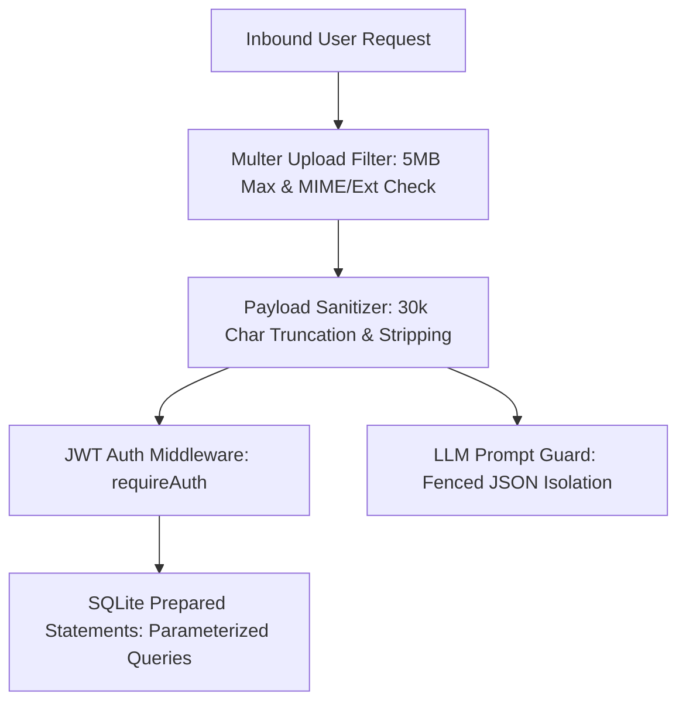

# Security Architecture & Hardening Runbook

This skill outlines the defensive security architecture, input validation rules, threat mitigations, and compliance checklists implemented across the **AI Resume & ATS Analyzer**.

---

## 1. Threat Model & Security Controls Map



| Threat Vector | Mitigation Strategy | File Reference |
| :--- | :--- | :--- |
| **Denial of Service (Large Files)** | Strict 5MB file size limit enforced at Multer storage layer. | `server/routes/analyze.js` |
| **Memory Exhaustion (Zip Bombs)** | Payload text truncated at 30,000 characters before LLM inference. | `server/routes/analyze.js` |
| **Malicious Executable Uploads** | Dual verification of MIME type and extension (`.pdf`, `.docx`, `.txt`). | `server/routes/analyze.js` |
| **SQL Injection** | Exclusively parameterized prepared statements (`better-sqlite3`). | `server/services/db.js` |
| **Credential Compromise** | Salted bcrypt hashing with 10 rounds; passwords never stored in plain text. | `server/services/authService.js` |
| **Session Hijacking** | Signed JWT bearer tokens with 7-day expiration and strict secret validation. | `server/services/authService.js` |
| **Prompt Injection** | Structured JSON schema mode enforcing isolated JSON response format. | `server/services/llm.js` |

---

## 2. File Upload & Buffer Security

### 2.1 Multer Security Configuration
In `server/routes/analyze.js`, file uploads are strictly limited:

```javascript
const upload = multer({
  storage: multer.memoryStorage(),
  limits: {
    fileSize: 5 * 1024 * 1024, // 5MB Maximum Ceiling
    files: 15,                  // Maximum 15 files for batch screening
  },
  fileFilter: (req, file, cb) => {
    const ext = path.extname(file.originalname).toLowerCase();
    const allowedExts = [".pdf", ".docx", ".doc", ".txt", ".md"];
    const allowedMimes = [
      "application/pdf",
      "application/vnd.openxmlformats-officedocument.wordprocessingml.document",
      "application/msword",
      "text/plain",
      "text/markdown",
    ];

    if (allowedExts.includes(ext) || allowedMimes.includes(file.mimetype)) {
      cb(null, true);
    } else {
      cb(new Error("Unsupported file format. Please upload PDF, DOCX, or TXT."));
    }
  },
});
```

### 2.2 Corrupt Buffer Isolation
All document parsers (`pdf-parse`, `mammoth`) are wrapped in `try-catch` blocks within `server/services/pdfParser.js`. Malformed PDF/DOCX buffers throw handled errors rather than crashing the Node process.

---

## 3. Payload Truncation & Token Exhaustion Defense

To prevent runaway LLM costs, memory pressure, and token overflow, resume text and job descriptions are sanitized:

```javascript
// Sanitizes and clamps raw text payload
const MAX_PAYLOAD_LENGTH = 30000;
const sanitizedResumeText = resumeText.slice(0, MAX_PAYLOAD_LENGTH).trim();
const sanitizedJd = jobDescription.slice(0, MAX_PAYLOAD_LENGTH).trim();
```

---

## 4. Authentication & Password Security

### 4.1 Password Hashing with Bcrypt
Passwords undergo 10 salt rounds before being stored in SQLite:

```javascript
import bcrypt from "bcryptjs";

export async function hashPassword(plainText) {
  return bcrypt.hash(plainText, 10);
}

export async function comparePassword(plainText, hash) {
  return bcrypt.compare(plainText, hash);
}
```

### 4.2 JWT Session Tokens
Tokens are signed with `JWT_SECRET` and verified on every protected request:

```javascript
export function requireAuth(req, res, next) {
  const authHeader = req.headers.authorization;
  if (!authHeader || !authHeader.startsWith("Bearer ")) {
    return res.status(401).json({ error: "Authentication required." });
  }

  const token = authHeader.split(" ")[1];
  const decoded = verifyToken(token);
  if (!decoded) {
    return res.status(401).json({ error: "Session expired or invalid token." });
  }

  req.user = decoded;
  next();
}
```

---

## 5. SQL Injection Immunity (SQLite WAL)

**Zero string-concatenated SQL queries exist in the codebase.** All database operations use `better-sqlite3` prepared statements:

```javascript
// Secure parameterized queries
const stmtFindUserByEmail = db.prepare(`SELECT * FROM users WHERE email = ?`);
const stmtInsertUser = db.prepare(`
  INSERT INTO users (id, email, password_hash, name)
  VALUES (@id, @email, @password_hash, @name)
`);
```

---

## 6. Security Audit Checklist for New Features

When adding new routes or services:
- [ ] Enforce `fileSize: 5MB` on any new file upload endpoint.
- [ ] Ensure any new database queries use `db.prepare()` with parameter binding.
- [ ] Verify error messages do not leak internal stack traces or database paths in production (`NODE_ENV === "production"`).
- [ ] Use `requireAuth` middleware for any user data modification routes.
- [ ] Test corrupt input handling in `tests/unit/`.
